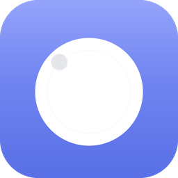

<p align="center">
  
</p>

<h1 align="center">SenseEase</h1>

<p align="center">
  Screen-motion comfort for Windows: it notices when on-screen motion gets intense and gently softens the edges of your view.<br>
  為 Windows 打造的螢幕動態舒適工具：偵測畫面動態，柔和地淡化視野周邊。
</p>

<p align="center">
  <b>Beta V1.3.2</b> &middot; Windows 10 / 11 (x64) &middot; .NET 8 / WPF &middot; runs fully on-device
</p>

---

## What it does

Fast scrolling, video, games and screen-sharing can make some people feel queasy or tired
(visually induced motion sickness). Motion in the **periphery** of your vision drives that
feeling far more than motion in the centre. SenseEase watches how much the screen is moving and,
when it builds up, dims the outer part of the screen with a soft overlay while leaving a clear
area where you are looking.

- **Senses screen motion.** Compares consecutive screen frames (Windows.Graphics.Capture) to estimate
  how much the picture is moving, and tells "you are scrolling" apart from "you are watching".
- **Builds up and settles down smoothly.** Motion is integrated over time, so a single jump does not
  trigger the overlay but sustained motion does, and the overlay eases off when things calm down.
- **Dims the periphery, keeps the centre clear.** A click-through overlay darkens the edges of the
  screen in 12 gentle steps, plus an optional faint stationary grid that gives your eyes a fixed
  reference.
- **Follows your head (optional).** With head tracking turned on, the clear area follows where you
  are facing, using the webcam.
- **Learns your comfort level.** It starts at a middle setting and adjusts to you over time from how you
  actually use it. Larger changes are proposed to you before they are applied.
- **Comfort Companion chat.** A small on-device assistant (Qwen3-4B) you can talk to in English or
  Traditional Chinese: ask how to use the app, adjust the overlay ("it's too dark"), or just say how you feel.
- **Health card and weekly recap.** An in-app summary of how often protection was on and how you felt.

SenseEase is a **general comfort tool, not a medical device**. It does not diagnose or treat any
condition. If symptoms are severe or persistent, please talk to a doctor.

## Privacy

- **Everything stays on your PC.** Screen analysis, head tracking and the chat model all run locally.
  Nothing is uploaded.
- **The camera is off by default.** Head tracking is opt-in. When it is on, only a head position
  and a few status flags cross from the tracker to the app; no images or face landmarks are sent or stored.
- **The overlay asks first.** Protection only engages after you consent, and you can switch it off at any time.

Details: [docs/SECURITY.md](docs/SECURITY.md) and [docs/HEAD-TRACKING-PRIVACY.md](docs/HEAD-TRACKING-PRIVACY.md).

## Install

The Beta is distributed as Windows installers in four variants, matched to the PC's AI hardware:

| Package | For | Chat runs on |
|---|---|---|
| **Auto** | AMD Ryzen AI or Intel PCs; installs the matching backend for the detected hardware | Ryzen AI NPU, or Intel NPU / iGPU |
| **AMD** | AMD Ryzen AI laptops | Ryzen AI NPU (FastFlowLM) |
| **OV-Cpp** | Intel Core Ultra laptops | Intel NPU / iGPU (OpenVINO GenAI, C++ host) |
| **OV-Python** | Intel Core Ultra laptops (fallback build) | Intel NPU / iGPU (OpenVINO GenAI, Python host) |

The installers are not published on GitHub yet; ask the maintainer for a copy. A source build can also
use a llama.cpp Vulkan backend (see below); the installers leave it out to save space.

## Build from source

Requirements: Windows 10/11 x64, the [.NET 8 SDK](https://dotnet.microsoft.com/download/dotnet/8.0),
Git and the GitHub CLI (`gh`). Visual Studio 2022 17.8+ is optional.

```powershell
git clone https://github.com/kirbyliu99M/SenseEase.git
cd SenseEase

# 1. Fetch the large files that are not in git (models, runtimes, sidecar builds).
#    Public files download from their original source; the rest come from a private store
#    (needs `gh auth login` and access). Everything is checked against pinned SHA-256 hashes.
powershell -ExecutionPolicy Bypass -File scripts\deps\Restore-Deps.ps1

# 2. Build, test, run
dotnet build SenseEase.Windows.sln
dotnet test SenseEase.Windows.sln
dotnet run --project src\SenseEase.App
```

The large files are needed to run the chat assistant and head tracking, not to compile the app. `Restore-Deps.ps1 -Verify` reports what is present without downloading
anything. The full list is in [docs/DEPENDENCIES.md](docs/DEPENDENCIES.md); more build notes are in [docs/BUILD.md](docs/BUILD.md).

## How it is built

```
Screen frames ──► Sensing ──► Inference ──► Adaptation ──► Rendering ──► Overlay on screen
 (WGC capture)    motion       leaky          auto-profile   per-pixel      clear centre,
 cursor, input    index        integrator     + Adaptive-Fit dimming field  dimmed periphery
                               → level 1-12   selector       + anchor grid
Webcam (opt-in) ──► head-tracker sidecar (MediaPipe) ──► where the clear centre sits
Chat ──► Comfort Companion ──► local LLM router: FastFlowLM (AMD NPU) / OpenVINO GenAI (Intel) / llama.cpp Vulkan (source builds)
```

| Path | Contents |
|---|---|
| `src/SenseEase.Core` | Engine logic with no UI dependencies: inference maths, profiles, Adaptive-Fit, safety floor |
| `src/SenseEase.Infrastructure` | Screen capture, inference engine, LLM backends and launchers, storage |
| `src/SenseEase.App` | WPF app: overlay, popup bar, chat, settings, tray, health card |
| `tests/SenseEase.Tests` | xUnit suite (2,142 tests) |
| `tools/head-tracker-sidecar` | Python + MediaPipe head-pose sidecar |
| `native/ov-genai-host*` | OpenVINO GenAI chat host (C++ and Python) |
| `installer/` | Inno Setup scripts and build/stage scripts for the four packages |
| `scripts/deps/` | Dependency manifest, restore and backup scripts |

The complete design, formulas and parameters are in the
[Technical Whitepaper](docs/TECHNICAL_WHITEPAPER.md).

## Documentation

- [Technical Whitepaper](docs/TECHNICAL_WHITEPAPER.md): architecture, theory, every parameter
- [User Handbook (EN)](docs/HANDBOOK_en.md) · [使用手冊 (繁中)](docs/HANDBOOK_zh-Hant.md)
- [Comfort Companion charter](docs/CHATBOT_CHARTER.md) and [safety provisions](docs/SAFETY-PROVISIONS.md)
- [Dependencies](docs/DEPENDENCIES.md) · [Build](docs/BUILD.md) · [Changelog](CHANGELOG.md) · [Project history](docs/PROJECT_HISTORY.md)

## Licence

No licence has been chosen yet. Until one is added, all rights are reserved by the author. Third-party
components (Qwen3 model weights, MediaPipe, OpenVINO, llama.cpp, FastFlowLM) are under their own licences,
listed in [docs/DEPENDENCIES.md](docs/DEPENDENCIES.md).
